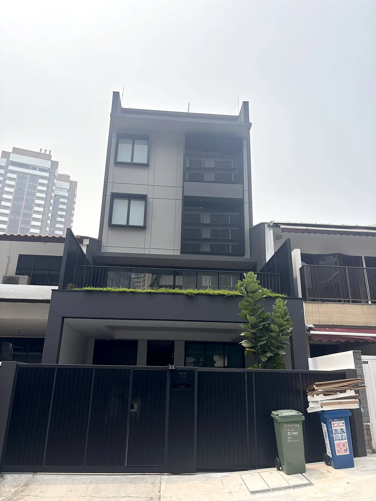
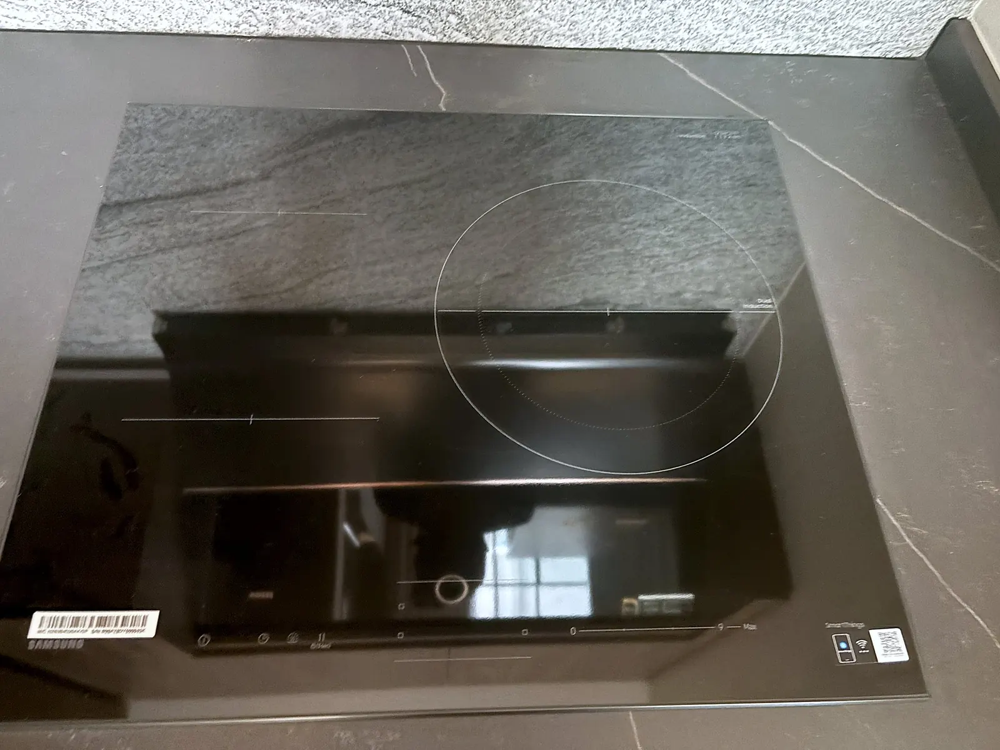
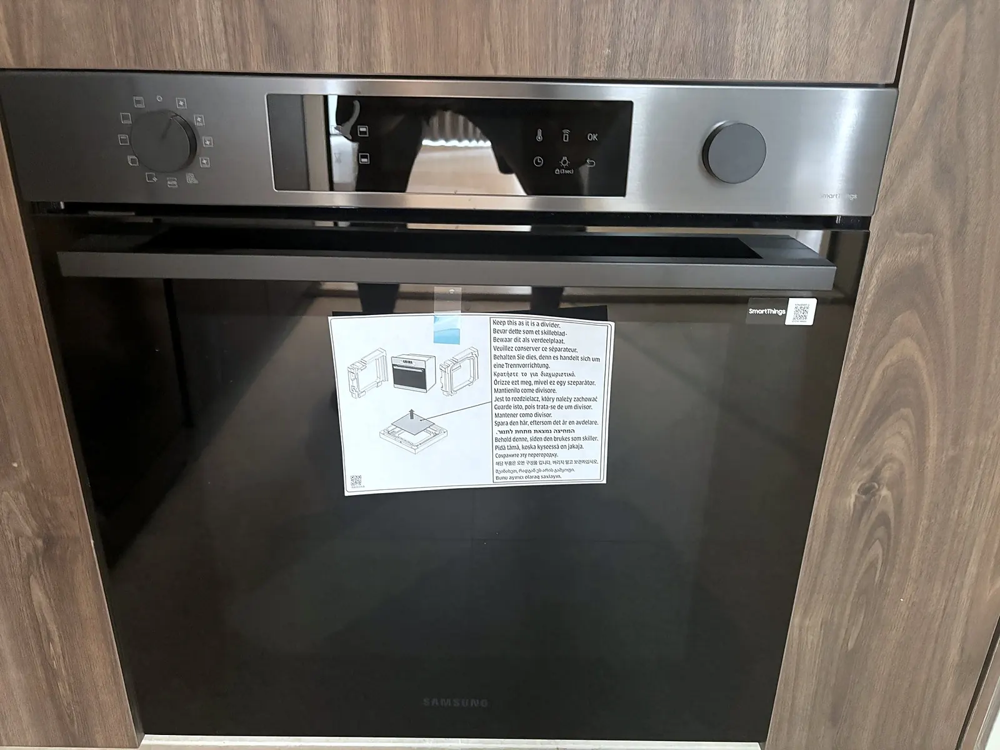
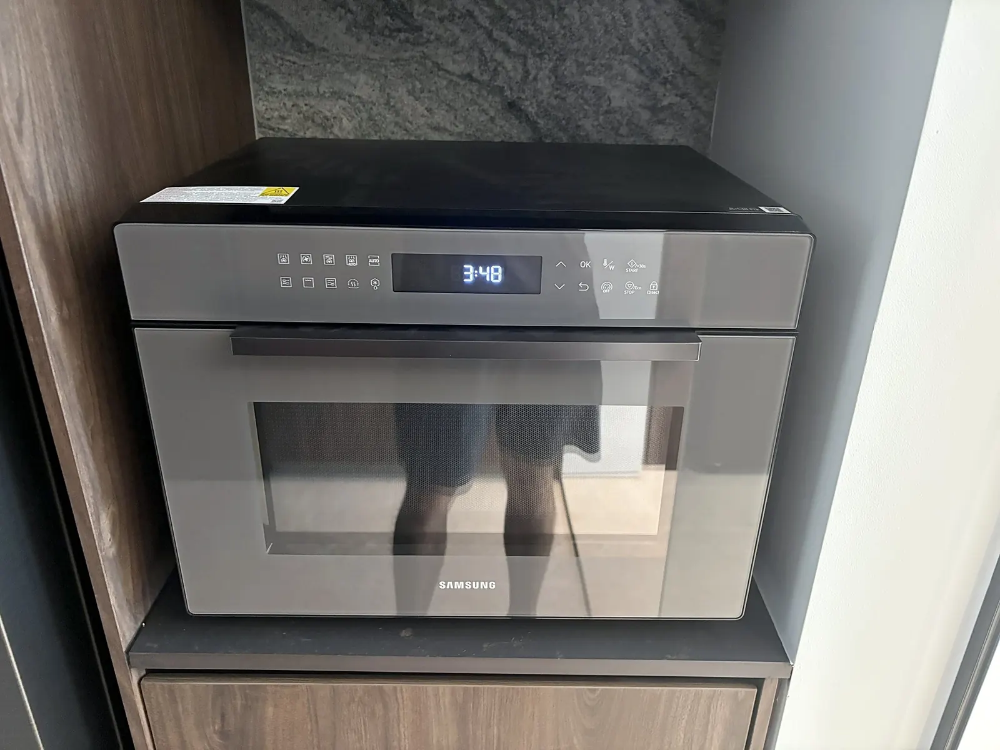
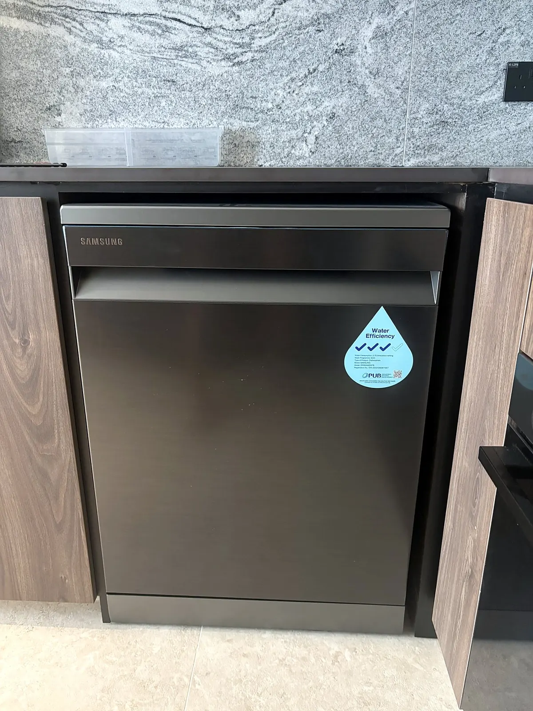
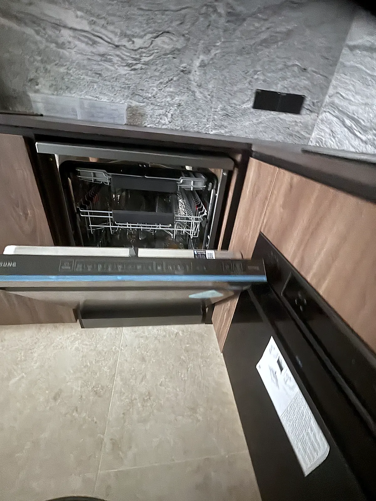
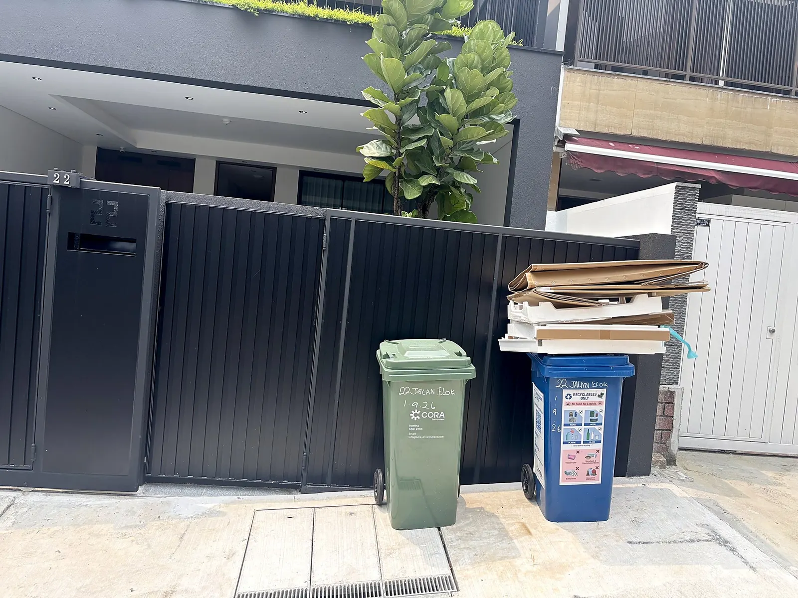
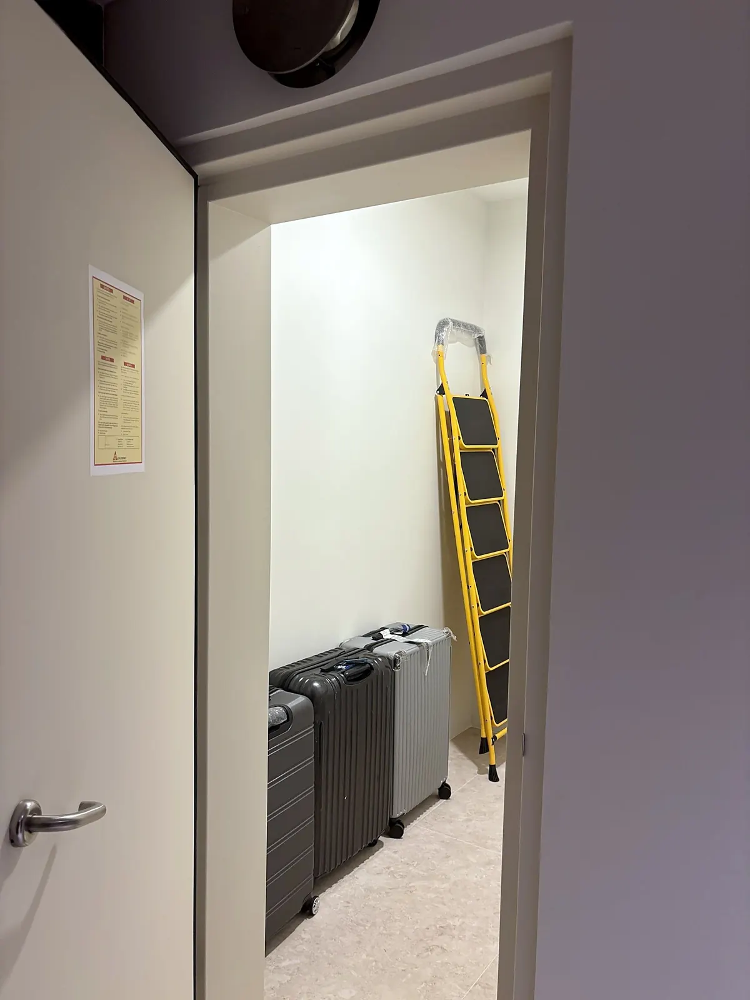
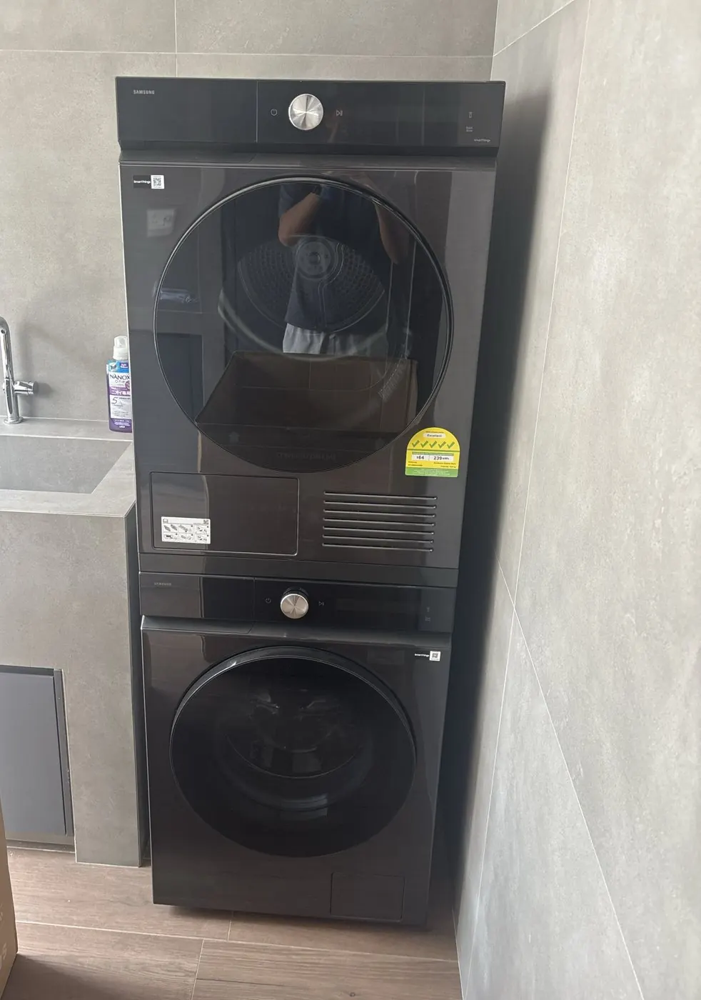

<!--
  Guide de la maison (français) — French copy of guide/guide.md
  ----------------------
  Keep this in step with the English guide: any change there needs the same
  change here. Same format as the English file (## heading, ### sub-heading,
  1. steps, - bullets, [to confirm] highlighted in yellow).
  - Photos:   (note the ../../)
  - Links to a section: the anchor is the heading text, lower-case, with
    spaces and punctuation turned into "-", e.g. "## Terrasse de buanderie (5e étage)" → #terrasse-de-buanderie-5e-étage
  - This page is PUBLIC. Never put door codes, Wi-Fi passwords or
    alarm codes here.
-->

_Dernière mise à jour : 15 octobre 2026_

Bienvenue chez vous. Ce guide rassemble tout ce qu'il faut savoir sur la vie quotidienne au 22 Jalan Elok. Si quelque chose n'est pas clair ou n'est plus à jour, écrivez-nous. Mieux vaut demander que deviner.

## Contacts utiles

| Qui | Comment |
|---|---|
| **Kevin (gestionnaire de la maison)** | [WhatsApp à Kevin](https://wa.me/6580167691?text=Hi%20Kevin%2C%20I%27m%20staying%20at%2022%20Jalan%20Elok.%20) · appeler le [+65 8016 7691](tel:+6580167691) · [info@22je.sg](mailto:info@22je.sg) |
| **Ambulance / pompiers** | [**995**](tel:995) |
| **Police (urgence)** | [**999**](tel:999) |
| **Police (hors urgence)** | [1800 255 0000](tel:18002550000) |
| **Pannes d'ascenseur (ligne ELETEC Elevators)** | [**+65 8128 9615**](tel:+6581289615) |

Sur votre téléphone, touchez un lien pour ouvrir une conversation WhatsApp avec Kevin ou appeler directement.

Kevin est votre premier interlocuteur pour tout ce qui concerne la maison. En cas d'urgence, appelez d'abord le numéro d'urgence, puis prévenez Kevin.

**Adresse :** 22 Jalan Elok, Singapore 229060

## Entrer et sortir

- **Porte d'entrée :** elle est équipée d'une serrure à code. Nous vous enverrons le code avec les identifiants wifi, peu avant votre date d'arrivée.
- **Votre chambre :** vous recevez **deux clés** de votre chambre.
- **Portail :** la télécommande du portail est remise à **une seule personne**.
- Refermez toujours le portail et verrouillez la porte d'entrée derrière vous, même pour sortir un instant.
- Ne communiquez jamais le code de la porte d'entrée à qui que ce soit.
- Si vous perdez une clé ou la télécommande, prévenez-nous immédiatement pour que nous puissions sécuriser la maison. Le remplacement coûte **S$10 par clé** et **S$50 par télécommande**.

## Wifi

Nous vous enverrons le nom du réseau et le mot de passe, avec le code de la porte d'entrée, peu avant votre date d'arrivée. La maison fonctionne avec des points d'accès wifi, et non avec un routeur accessible aux résidents ; si le wifi coupe ou ralentit, prévenez-nous et nous nous en occuperons.

## Votre chambre

- **Climatisation :** gardez les fenêtres et la porte fermées quand elle est allumée, et éteignez-la en sortant.
- **Rideaux occultants :** fermez-les complètement pour une chambre plongée dans le noir à toute heure.
- **Salle de bains privative :** la ventilation fonctionne dès que la lumière de la salle de bains est allumée. Après la douche, laissez la lumière allumée quelques minutes (ou la porte ouverte) pour évacuer la vapeur et éviter les moisissures. Ne jetez que du papier toilette dans les WC.
- **Veilleuse :** si vous en souhaitez une, demandez-la-nous.
- **Le ménage** de votre chambre est fait **chaque samedi**. **Il ne comprend pas le linge :** la buanderie est en libre-service, sur la [terrasse de buanderie](#terrasse-de-buanderie-5e-étage).
  - **Le ménage hebdomadaire fait partie de chaque séjour et n'est pas optionnel.** Il permet de garder chaque chambre propre et en bon état. Nous frappons toujours avant d'entrer, mais s'il n'y a pas de réponse, nous entrons quand même.

## Espaces communs

Vous pouvez profiter du **salon, de la salle à manger et de la cuisine**, du **balcon ouvert attenant au salon** (2e étage) et de la **terrasse à l'avant**.

Un **robot aspirateur** nettoie le salon et la salle à manger (2e étage) **tous les jours**. Laisser le sol dégagé (sacs, chaussures, câbles) l'aide à faire un nettoyage complet.

- Lavez, séchez et rangez tout ce que vous utilisez dans la cuisine.
- Il y a **deux réfrigérateurs partagés** et aucun réfrigérateur dans les chambres. Jetez ce qui est périmé.
- **Étiquetez clairement avec votre chambre tout ce que vous rangez dans les réfrigérateurs et les espaces communs.** Ce qui n'est pas clairement étiqueté sera jeté lors du ménage du samedi.
- Essuyez la plaque et le plan de travail après avoir cuisiné.
- Fermez les portes du balcon quand il pleut et quand vous êtes le dernier à partir.

## Électroménager de la cuisine

Tout l'électroménager de la cuisine est de marque Samsung. Merci de l'essuyer après usage et de le laisser tel que vous l'avez trouvé.

### Plaque à induction

1. **Utilisez uniquement des casseroles compatibles induction.** Le fond doit être plat et magnétique : si un aimant de réfrigérateur y adhère, elle convient.
2. Touchez **⏻** pour allumer la plaque, posez la casserole sur l'une des **trois zones de cuisson**, puis faites glisser votre doigt sur la **barre 0–9** pour régler la puissance (**Max** est la plus forte). La grande zone a un double anneau qui s'adapte à la taille de la casserole.
3. Allumez la **hotte** au-dessus de la plaque pendant la cuisson.
4. **Besoin de tout arrêter rapidement ?** Touchez **‖** pour mettre toutes les zones en pause en même temps.
5. Touchez de nouveau **⏻** quand vous avez terminé. Le verre reste chaud un moment après la cuisson : n'y touchez pas.
6. **Si les commandes ne répondent pas,** la sécurité enfants est peut-être activée : maintenez la touche cadenas enfoncée 3 secondes.

Soulevez les casseroles plutôt que de les faire glisser, pour ne pas rayer le verre. Essuyez les débordements une fois la plaque refroidie.

### Four

1. Tournez le **bouton de gauche** sur le mode de cuisson voulu, par exemple chaleur tournante ou gril.
2. Tournez le **bouton de droite** pour régler la température, puis touchez **OK**.
3. Laissez le four préchauffer avant d'enfourner, et utilisez toujours des maniques.
4. Quand vous avez terminé, remettez le **bouton de gauche** sur la position **arrêt**.

Ne tapissez pas le fond du four de papier aluminium, et gardez la porte du four fermée quand vous ne l'utilisez pas : le lave-vaisselle voisin ne peut pas s'ouvrir tant que la porte du four est ouverte.

### Micro-ondes combiné

C'est un micro-ondes qui peut aussi griller et cuire au four.

- **Réchauffer rapidement :** placez les aliments dans un récipient adapté au micro-ondes, fermez la porte et appuyez sur **Start / +30s**. Chaque pression ajoute 30 secondes à pleine puissance.
- **Autres modes :** touchez le mode voulu, réglez la durée avec **▲ ▼**, touchez **OK**, puis appuyez sur **Start**.
- **Stop / Eco :** une pression pour mettre en pause, deux pour annuler.
- **N'y mettez jamais de métal, de papier aluminium ou de récipient fermé** en mode micro-ondes. En mode gril ou four, le récipient et l'intérieur deviennent très chauds.
- **Si les touches ne répondent pas,** la sécurité enfants est peut-être activée : maintenez le cadenas enfoncé 3 secondes.

### Lave-vaisselle

> **⚠️ Fermez la porte du four avant d'ouvrir le lave-vaisselle.**
>
> Le lave-vaisselle et le four se rejoignent dans l'angle : la porte du lave-vaisselle ne peut pas s'ouvrir tant que celle du four est ouverte.

1. Jetez d'abord les restes à la poubelle.
2. Placez les assiettes dans le panier du bas, tournées vers le centre, et les tasses et verres à l'envers dans le panier du haut. Vérifiez que rien ne bloque les bras de lavage rotatifs.
3. Mettez **une tablette pour lave-vaisselle** dans le distributeur à l'intérieur de la porte et refermez son couvercle. **Les tablettes sont fournies** : elles sont sous l'évier.
4. Fermez la porte, choisissez un programme sur les commandes situées sur le bord supérieur de la porte, puis lancez-le.
5. Une fois le cycle terminé, rangez la vaisselle propre. Si vous trouvez le lave-vaisselle plein de vaisselle propre, videz-le avant d'y mettre la vôtre.

Ne mettez pas au lave-vaisselle les planches et ustensiles en bois, les poêles antiadhésives ni rien qui ne soit marqué « dishwasher safe » (compatible lave-vaisselle) ; lavez-les à la main.

## L'ascenseur

- Ne bloquez pas les portes de l'ascenseur et ne les forcez jamais.
- Ne dépassez pas la charge indiquée dans la cabine. Pour les bagages lourds, faites un trajet à la fois.
- Si l'ascenseur s'arrête entre deux étages, appuyez sur le bouton d'alarme dans la cabine et appelez **ELETEC Elevators au +65 8128 9615**, puis prévenez Kevin. N'essayez pas de sortir par vous-même.
- Si l'ascenseur ne fonctionne pas, appelez ELETEC au même numéro et prévenez Kevin.

## Déchets

Singapour prend les déchets très au sérieux, et avec la chaleur, les déchets qui traînent attirent vite fourmis et nuisibles. **Il n'y a pas de poubelle commune à l'intérieur de la maison** : merci de sortir vous-même vos déchets.

1. Mettez tous vos déchets dans des sacs et **fermez-les bien**.
2. Emballez d'abord les déchets alimentaires humides dans un petit sac à part, pour éviter les fuites.
3. Déposez-les dans la **poubelle verte près du portail**. Ne laissez aucun sac poubelle dans la maison, y compris dans la cuisine.
4. Refermez bien le couvercle de la poubelle. Ne laissez jamais de sacs à côté, même pour une nuit.

Les déchets sont collectés **tous les jours**.

**Recyclage :** le papier, le plastique, le verre et le métal propres et secs peuvent aller dans la **poubelle bleue**. En cas de doute, mettez-les dans la poubelle verte avec les autres déchets.

## Rangement des bagages

Un local à bagages se trouve **près de l'entrée, au 1er étage** : vous pouvez y ranger vos valises vides pour libérer votre chambre. Merci d'étiqueter vos valises avec votre chambre.

## Terrasse de buanderie (5e étage)

La terrasse de buanderie est une terrasse ouverte au 5e étage, de l'autre côté du palier de l'ascenseur, face à la Suite Aurelia. **La buanderie est en libre-service :** le ménage ne comprend pas le lavage du linge, merci donc de le faire ici vous-même. Elle est **gratuite et accessible à toute heure**. Merci de rester discret tard le soir et tôt le matin.

**Vous ne savez pas comment fonctionnent les machines ?** Demandez-nous, nous vous montrerons volontiers.

Les deux machines sont des modèles **Samsung Bespoke AI** à molette unique. Le **lave-linge** (hublot 9 kg, modèle WW90DB8U94GBSP) est la **machine du bas**, et le **sèche-linge** (pompe à chaleur 10 kg, modèle DV10BB9440GBSP) est **au-dessus**. Les inscriptions des machines sont en anglais. Chacune a trois commandes :

| Commande | Fonction |
|---|---|
| **⏻ Power (marche/arrêt)** | Allume et éteint la machine |
| **Molette** | Tournez-la pour choisir un programme (son nom s'affiche à l'écran) ; appuyez dessus pour voir les options |
| **▷‖ Start / Pause (départ / pause)** | Lance le programme ou le met en pause |

### Utiliser le lave-linge (machine du bas)

1. **Préparez le linge :** videz les poches (mouchoirs et pièces sont les pires ennemis), fermez les fermetures éclair et mettez le linge délicat et les soutiens-gorge dans un filet de lavage. Lavez séparément le linge foncé et le blanc.
2. **Chargez :** remplissez le tambour sans tasser, **aux trois quarts environ** au maximum. Fermez la porte jusqu'au clic.
3. **Ajoutez la lessive :** tirez le tiroir en haut à gauche du lave-linge et versez un bouchon de lessive liquide dans le compartiment à lessive. N'utilisez pas les grands réservoirs Auto Dispense (dosage automatique), nous ne les remplissons pas. **La lessive est fournie** : utilisez le flacon sur l'étagère en face des machines. Un bouchon suffit largement, les machines à hublot en demandent très peu.
4. Appuyez sur **⏻ Power**.
5. **Tournez la molette** pour choisir un programme :
   - **AI Wash** ou **Cotton** (coton) : vêtements du quotidien, serviettes et linge de lit
   - **Synthetics** (synthétiques) : vêtements de sport, polyester
   - **Delicates** (délicat) ou **Wool** (laine) : ce que vous laveriez normalement à la main
   - **Quick Wash 15'** (lavage rapide 15 minutes) : petite charge peu sale
   - **Super Speed** (super rapide) : une charge normale quand vous êtes pressé (environ 39 minutes)
   - **Bedding** (linge de lit) et **Towels** (serviettes) : comme leur nom l'indique
6. Appuyez sur **▷‖ Start**. La porte se verrouille pendant le cycle.
7. À la fin, sortez rapidement votre linge et **laissez la porte entrouverte** pour aérer le tambour.

**Vous avez oublié quelque chose ?** Appuyez sur **▷‖** pour mettre en pause. Une fois la porte déverrouillée, ajoutez l'article, refermez la porte et appuyez de nouveau sur **▷‖**.

### Utiliser le sèche-linge (machine du haut)

> **⚠️ Nettoyez le filtre à peluches avant chaque séchage, sinon votre linge ressortira humide.**
>
> Un filtre encrassé bloque la circulation de l'air : le sèche-linge tourne plus longtemps et le linge ressort quand même mouillé. Cela ne prend que dix secondes (voir l'étape 2). Merci de le nettoyer même si la personne précédente ne l'a pas fait.

1. **Vérifiez les étiquettes.** Ne passez pas au sèche-linge la laine, la soie, la dentelle ni tout ce qui porte la mention « do not tumble dry » (ne pas sécher en machine). N'y mettez jamais de chaussures, de tapis à envers caoutchouté ni rien qui contienne du caoutchouc ou de la mousse.
2. **Nettoyez le filtre à peluches avant chaque séchage.** Il se trouve dans l'encadrement de la porte. Sortez-le, ouvrez-le, retirez les peluches avec les doigts, puis refermez-le et remettez-le en place. Sans cela, votre linge ressortira humide.
3. Chargez le linge sans tasser et fermez la porte.
4. Appuyez sur **⏻ Power**, **tournez la molette** pour choisir un programme (**AI Dry** ou **Cotton** conviennent à la plupart des charges, **Synthetics** aux vêtements de sport), puis appuyez sur **▷‖ Start**. Pas de bac à vider : le sèche-linge évacue l'eau directement dans les canalisations.
5. Sortez votre linge dès la fin du programme. Il sera moins froissé.

### Merci de ne pas

- Surcharger l'une ou l'autre machine, ni laver ou sécher des tapis à envers caoutchouté ou des chaussures.
- Laisser votre linge dans les machines après la fin du cycle. D'autres attendent peut-être.
- Poser quoi que ce soit sur le sèche-linge, ni vous appuyer sur les machines superposées.
- Ouvrir le capot en bas à l'avant du sèche-linge. Nous nettoyons ce filtre lors du ménage.

### En cas de problème

- **La porte ne s'ouvre pas :** attendez une ou deux minutes après la fin du cycle, la porte se déverrouille d'elle-même. Si elle ne s'ouvre toujours pas, écrivez-nous. Ne forcez pas.
- **L'écran affiche un code d'erreur :** prenez l'écran en photo et envoyez-la-nous par WhatsApp.
- **De l'eau au sol :** éteignez la machine avec **⏻**, puis écrivez-nous.

## Heures calmes et règles de la maison

- **Heures calmes :** de 22 h à 8 h. Pendant ces heures, baissez le volume des conversations, de la musique et des appels dans les espaces communs.
- **Interdiction de fumer ou de vapoter dans toute la maison**, balcon et terrasse avant compris.
- **Pas d'invités supplémentaires.** Seules les personnes nommées sur votre bail peuvent séjourner dans la maison.
- **Pas d'animaux.**
- Merci de ne pas déplacer de meubles d'une chambre à l'autre ni de fixer quoi que ce soit aux murs sans nous demander d'abord.

## Départ

1. Indiquez-nous à l'avance la date et l'heure de votre départ.
2. Laissez la chambre en ordre, retirez votre nourriture des réfrigérateurs et sortez vos déchets dans la poubelle près du portail.
3. **Prenez la chambre en photo avant de partir**, par précaution : toute la chambre, la salle de bains et tout ce que vous voulez garder en mémoire. Conservez ces photos jusqu'au remboursement de votre dépôt.
4. Rendez les deux clés de la chambre, ainsi que la télécommande du portail si vous l'avez. Toute clé manquante est facturée S$10, toute télécommande manquante S$50.
5. Nous inspectons la chambre après votre départ et remboursons votre dépôt sous 7 jours.
